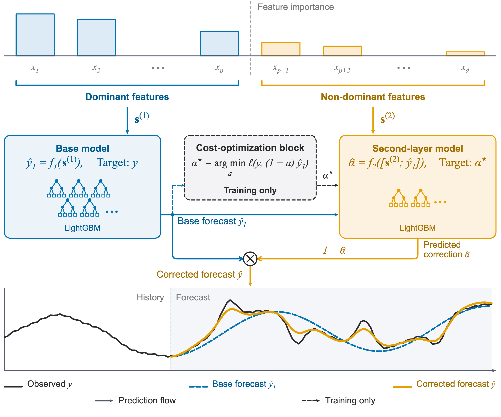

<div align="center">

<h1>HEFS: Hierarchical ensemble-based feature selection for time series prediction</h1>

**Digital Signal Processing · 2026**

[Huseyin Karaca](https://hkaraca.com/), Aysin Tumay, Ali Taha Koc, Suleyman Serdar Kozat<br>
Bilkent University

[[Paper](https://doi.org/10.1016/j.dsp.2025.105528)] [[Project page](https://hkaraca.com/hefs/)] [[Slides](https://hkaraca.com/assets/pdf/grc26-presentation.pdf)]

</div>

HEFS is a hierarchical feature selection method for high-dimensional, non-stationary time series prediction. A first layer forecasts from the dominant features. Each next layer uses the remaining features to learn a cost-optimized scale that corrects the previous forecast. This is the official implementation of the *Digital Signal Processing* (2026) paper, with two- and three-layer LightGBM estimators.

<p align="center"></p>
<p align="center"><em>The second layer takes the non-dominant features and the first forecast, and learns the scale α that rescales it.</em></p>

## Quick start

Python 3.10+. Run from the repository root:

```bash
git clone https://github.com/huseyin-karaca/hefs.git && cd hefs
python -m venv .venv && source .venv/bin/activate
pip install -r requirements.txt
python code/quickstart.py    # prints HEFS and LightGBM test MAE on generated data
```

## Use on your own data

Order the columns of `X` so the dominant features come first. The estimator follows the scikit-learn API.

```python
import sys; sys.path.insert(0, "code")
from models_hefs import HierarchicalLightGBMRegressor

model = HierarchicalLightGBMRegressor(feat_split=(p, q))   # p dominant, q complementary features
model.fit(X_train, y_train)
y_pred = model.predict(X_test)
```

## Citation

```bibtex
@article{karaca2026hefs,
  title   = {Hierarchical ensemble-based feature selection for time series prediction},
  author  = {Karaca, Huseyin and Tumay, Aysin and Koc, Ali Taha and Kozat, Suleyman Serdar},
  journal = {Digital Signal Processing},
  volume  = {168},
  pages   = {105528},
  year    = {2026},
  doi     = {10.1016/j.dsp.2025.105528}
}
```
