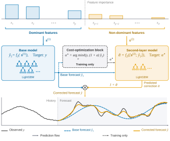

# Hierarchical ensemble-based feature selection for time series prediction

HEFS predicts from dominant features, then learns a multiplicative correction from complementary features. This repository provides two- and three-layer LightGBM implementations.

**Huseyin Karaca, Aysin Tumay, Ali Taha Koc, Suleyman Serdar Kozat**

Bilkent University · *Digital Signal Processing*, 168, 105528 (2026)

[Project website](https://hkaraca.com/hefs/) · [Paper](https://doi.org/10.1016/j.dsp.2025.105528) · [Slides](https://hkaraca.com/assets/pdf/grc26-presentation.pdf) · [BibTeX](CITATION.bib)

<p align="center">
  
</p>

## Quickstart

Python 3.10+. Run from the repository root:

```bash
python3 -m venv .venv
source .venv/bin/activate
python -m pip install -r requirements.txt
python code/quickstart.py
```

On Windows, activate with `.venv\Scripts\activate`.

The example generates its own data and prints HEFS and LightGBM prediction errors.
