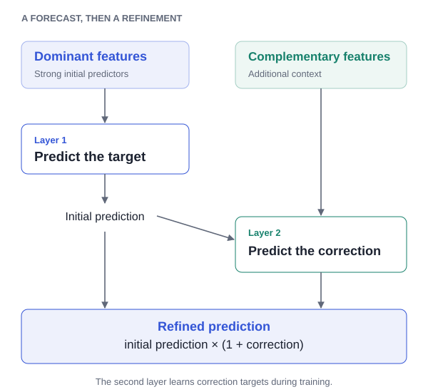

# HEFS

### Hierarchical ensemble-based feature selection for time series prediction

**Use dominant features to predict. Use complementary features to refine.**

[Project website](https://hkaraca.com/hefs/) · [Paper / DOI](https://doi.org/10.1016/j.dsp.2025.105528) · [Method](docs/method.md) · [Results](docs/results.md) · [Reproduce](docs/reproduce.md) · [BibTeX](CITATION.bib)

**Huseyin Karaca, Aysin Tumay, Ali Taha Koc, Suleyman Serdar Kozat**  
Bilkent University · *Digital Signal Processing*, 168, 105528 (2026)  
Available online August 2025

<p align="center">
  
</p>

## Why HEFS?

When samples are limited and features are numerous, a model can rely on a small dominant group and underuse other informative signals. Selecting only the strongest features can also discard useful context. HEFS assigns feature groups to successive models so complementary information can refine the initial prediction.

1. **Predict:** train the first model on dominant features.
2. **Optimize:** search for scaling corrections that minimize a final loss on training data.
3. **Learn the correction:** train the next model on complementary features plus the preceding prediction, using the searched corrections as targets.
4. **Refine:** at inference, apply the learned relative correction: `final = initial × (1 + correction)`.

The repository provides two- and three-layer LightGBM implementations. HEFS organizes feature use across a hierarchy; it does not return a single selected feature subset. Features must be grouped and ordered before fitting. See [the method](docs/method.md) for the distinction between training and inference, correction alignment, and scaling.

## Published results

Reported test errors from **Table 3**; lower is better:

| Method | Synthetic | M4 | Weather |
| --- | ---: | ---: | ---: |
| Baseline LightGBM | 0.980 | 0.105 | 0.0120 |
| Backward wrapper | 0.980 | 0.107 | 0.0110 |
| **HEFS (K=2)** | **0.956** | **0.103** | **0.0110** |
| HEFS (K=3) | 0.977 | 0.111 | 0.0153 |
| HEFS ablation | 0.962 | 0.106 | 0.0122 |

The two-layer model has the lowest displayed test error on Synthetic and M4 and ties backward selection on Weather. On Weather its reported mean fit time is **2.238 s**, compared with **99.60 s** for backward selection, approximately **44.5× shorter** (Table 6). These are mean fit times, not total search times. Full-feature LightGBM is faster than HEFS on Weather.

**Metric note:** the paper captions Table 3 “Test MSE,” while its prose and evaluation protocol describe MAE. The scripts use MAE for search and result aggregation. The values above are reproduced as published and labeled “reported test error” pending verification against the original per-run results. They are not results from a new run.

Three layers do not consistently improve generalization. Differences are not statistically significant for every comparison, and benefits may diminish with abundant data or unclear feature-group structure. [Full tables, timing details, significance, and limitations →](docs/results.md)

## Quickstart

Requires **Python 3.10+**. From the repository root:

```bash
python3 -m venv .venv
source .venv/bin/activate
python -m pip install -r requirements.txt
python examples/quickstart.py
```

Windows activation: `.venv\Scripts\activate`. If LightGBM cannot load its native library, consult its [installation guide](https://lightgbm.readthedocs.io/en/stable/Installation-Guide.html) for platform-specific OpenMP setup.

The example generates a time-ordered regression dataset, uses a chronological holdout, and prints HEFS and single-model MAE. It runs without external datasets or checkpoints. **It demonstrates usage, not reproduction of the paper’s results.**

For your own arrays:

```python
from models_hefs import HierarchicalLightGBMRegressor

# X must contain 8 columns ordered as [4 dominant | 4 complementary].
model = HierarchicalLightGBMRegressor(
    feat_split=(4, 4),
    beta=0.1,
    random_state=42,
    lgb_params_layer1={"n_estimators": 100, "verbosity": -1},
    lgb_params_layer2={"n_estimators": 100, "verbosity": -1},
)
model.fit(X_train, y_train)
y_pred = model.predict(X_test)
```

Keep temporal order for time-series inputs. Fit any ranking or grouping procedure on training data only and preserve the same column ordering at prediction time. The two-layer model uses the first `p + q` columns by position; it does not rank features itself. Its correction targets use a one-position circular shift during training; see [implementation notes](docs/method.md).

## Repository guide

| Path | Purpose |
| --- | --- |
| `models_hefs.py` | Two-layer `HierarchicalLightGBMRegressor` |
| `models_hefs3.py` | Three-layer `HierarchicalLGBM_K3` |
| `models_ablation.py` | Additive residual ablation |
| `models_baseline.py`, `models_filter.py`, `models_embedded.py`, `models_ensemble.py` | Comparison models |
| `den_synt0.py`, `den_m4n.py`, `den_weather.py` | Original experiment scripts |
| `hus_helper.py`, `load_weather2.py` | Data loading, feature engineering, and evaluation |
| `examples/quickstart.py` | Standalone generated-data example |
| `docs/`, `overrides/`, `mkdocs.yml` | Static project website |
| `docs/data/paper_results.csv` | Published Table 3 and Table 6 values |
| `tools/site_assets.py` | Regenerate SVG figures and full result tables |
| `CITATION.bib` | Paper citation |

## Reproducing the paper

The experiment scripts cover Synthetic, M4, and Weather, with dataset construction, model comparisons, hyperparameter search, and evaluation. The standalone quickstart provides a small example of the two-layer estimator on generated data.

See [the reproduction guide](docs/reproduce.md) for dataset sources, experiment settings, dependencies, and the model API.

## Project website

The site uses Material for MkDocs, with styling aligned to [HiT-ASR](https://hkaraca.com/hit-asr/). Use Python 3.12 for the pinned documentation environment. To build and preview it:

```bash
python -m pip install -r requirements-docs.txt
python tools/site_assets.py
python -m mkdocs build --strict
python -m mkdocs serve
```

The configured website address is [hkaraca.com/hefs](https://hkaraca.com/hefs/). The source repository is [huseyin-karaca/hefs](https://github.com/huseyin-karaca/hefs). Serve the generated `site/` directory at `/hefs/` on the domain; building locally does not publish the site. The included GitHub Actions workflow validates the example and build, then uploads the static files as a workflow artifact.

## Citation

```bibtex
@article{karaca2026hefs,
  title   = {Hierarchical ensemble-based feature selection for time series prediction},
  author  = {Karaca, Huseyin and Tumay, Aysin and Koc, Ali Taha and Kozat, Suleyman Serdar},
  journal = {Digital Signal Processing},
  volume  = {168},
  pages   = {105528},
  year    = {2026},
  doi     = {10.1016/j.dsp.2025.105528}
}
```

## Contact and licensing

For questions, [open an issue](https://github.com/huseyin-karaca/hefs/issues) or visit [hkaraca.com](https://hkaraca.com/).

No code license is currently included. The paper and third-party datasets retain their respective rights and terms; this README does not assign a license.
