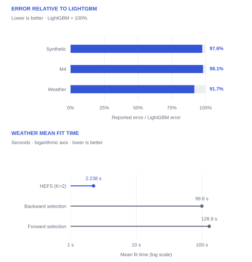

## The signal you leave behind

When training data are scarce relative to the number of features, a predictor can rely heavily on a few strong signals. Selecting only those features may discard complementary information. Feeding everything into a single model does not guarantee that weaker signals will be used effectively either.

**HEFS gives different feature groups distinct roles.** The first model makes a prediction. The next learns how complementary information should adjust it. This is particularly relevant for non-stationary time series, where the relationships that matter can change.

<div class="steps" markdown>
<div class="step" markdown>
<span class="number">01 / PREDICT</span>
### Start with dominant features
Use domain knowledge or a training-set relevance score to form the first group. Train an initial predictor on those features.
</div>
<div class="step" markdown>
<span class="number">02 / LEARN TO REFINE</span>
### Make room for the others
Search for useful scaling corrections during training. A second model learns them from complementary features and the first prediction.
</div>
<div class="step" markdown>
<span class="number">03 / COMBINE</span>
### Apply a learned correction
At inference, multiply the first prediction by one plus the predicted correction. No observed test target is needed.
</div>
</div>

## What the experiments show

The paper compares LightGBM-based methods on a synthetic dataset, M4 Yearly, and Weather. The two-layer HEFS model has the lowest reported test error on Synthetic and M4, and ties backward selection on Weather at the published precision.

<figure markdown>

<figcaption>Values transcribed from Tables 3 and 6. Relative error is calculated within each dataset; the datasets have different target scales. Training times are reported mean fit times, not full search runtimes.</figcaption>
</figure>

On Weather, HEFS has the same displayed test error as backward selection, with a reported mean fit time of **2.238 s versus 99.60 s**. The advantage is not universal: three layers do not consistently improve test error, and benefits may diminish with abundant data or no clear feature-group structure.

[Explore the results and metric note →](results.md)

## A small hierarchy, an explicit objective

The key connection between layers is a **cost-optimization block**: it searches for a scaling correction that minimizes a chosen final loss, then uses that correction as a training target. This search does not require differentiating the final loss. The supplied implementation uses LightGBM learners and absolute-error correction search.

HEFS organizes how features are used; it does not simply return one selected subset. The estimator expects the columns to be arranged into groups before fitting.

<div class="reading-links" markdown>
[Method and diagrams](method.md) · [Full results](results.md) · [Run the quickstart](reproduce.md) · [Author’s website ↗](https://hkaraca.com/)
</div>

## Cite this work

Published in *Digital Signal Processing*, volume 168, article 105528 (2026); available online August 2025. [Publisher / DOI](https://doi.org/10.1016/j.dsp.2025.105528).

```bibtex
--8<-- "CITATION.bib"
```

