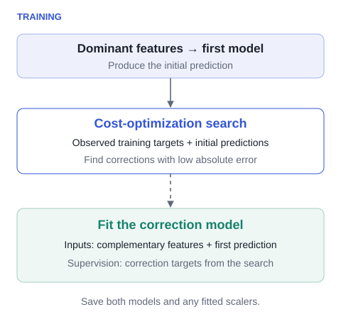
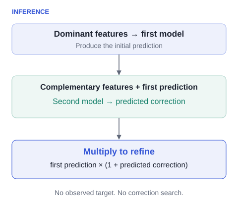

# How HEFS works

Different feature groups contribute at different stages: first a prediction, then a learned relative adjustment.

## 1. Assign feature groups

Partition the input into non-overlapping groups. The first contains dominant features; later groups contain complementary signals. Domain knowledge, relevance scores, or another grouping strategy can determine the assignment.

For a forecasting task, the first group might contain target lags and rolling statistics, while later groups contain calendar variables or exogenous measurements. These are examples, not fixed requirements. In the paper’s Weather experiment, mutual information determines feature relevance, and the split location is tuned.

**The Python estimator uses column position.** For `feat_split=(p, q)`, the first `p` columns go to layer 1 and the next `q` to layer 2. It does not rank or reorder features internally. Compute any data-driven ordering using the training data only, and preserve the same ordering at inference.

## 2. Fit the first predictor

Train a base model on the dominant group to predict the target. In the supplied two-layer model this is a LightGBM regressor. Feature and target min-max scaling are optional and fitted on the training data.

initial prediction = f₁(dominant features)

## 3. Turn useful corrections into training targets

The cost-optimization block searches over relative adjustments to the first prediction. For a correction `a`, the adjusted prediction is `(1 + a) × initial prediction`.

a* = argmin over a ∈ [−β, β] of loss(y, (1 + a) × initial prediction)

The paper describes a general loss-based search. The implementation evaluates a finite grid using absolute error. Because the search evaluates the loss directly, it does not need a gradient of that loss. This property concerns the correction search; the base learners retain their own training objectives.

The second model receives both the complementary features and the first model’s prediction. Its regression target is the correction found by the search, rather than the original target or an additive residual.

<figure markdown>

<figcaption>Training only: observed targets help construct correction targets. The dashed connection is supervision, not an inference input.</figcaption>
</figure>

!!! note "Implementation detail: temporal alignment"
    `models_hefs.py` constructs correction targets from one-position-rolled training targets and predictions (`np.roll`). The first position therefore wraps around to the last training observation. The three-layer implementation instead initializes its first correction target to zero. These details matter for exact replication; the diagrams explain the conceptual architecture. Keep samples in temporal order when using the estimator for time series.

## 4. Predict without observed targets

At inference, the first model predicts from its feature group. The second predicts a correction from the next group and the first prediction. The result is multiplied, then transformed back to the original target scale if target scaling was enabled.

final prediction = [1 + f₂(complementary features, initial prediction)] × initial prediction

<figure markdown>

<figcaption>Inference: both models use input features and learned parameters. No target values or correction search are required.</figcaption>
</figure>

For illustration, if the initial prediction is `20` and the learned correction is `−0.1`, the refined prediction is `18`. This arithmetic example is not an experimental result. If target scaling is enabled, the multiplication happens in scaled target space.

## More layers, and the role of β

The framework can repeat this process across more groups. The repository includes a three-layer implementation, `HierarchicalLGBM_K3`, which requires exactly three groups whose sizes sum to the input dimension. Two layers gave the strongest test results in the paper.

`beta` controls the grid used to construct correction targets during training. The two-layer implementation uses a default search of approximately ±0.33 when `beta` is unspecified. **Predicted corrections are not clipped to that grid at inference**, so the search interval is not a guaranteed bound on outputs.

## When to consider it

HEFS is motivated by limited samples, many features, non-stationarity, and identifiable groups with unequal predictive strength. It may offer less benefit when abundant data allow a single model to use all informative features, or when no meaningful dominant/complementary grouping exists. Group assignment remains an important design choice rather than an automatically solved part of the estimator.

[See the experimental evidence →](results.md)

