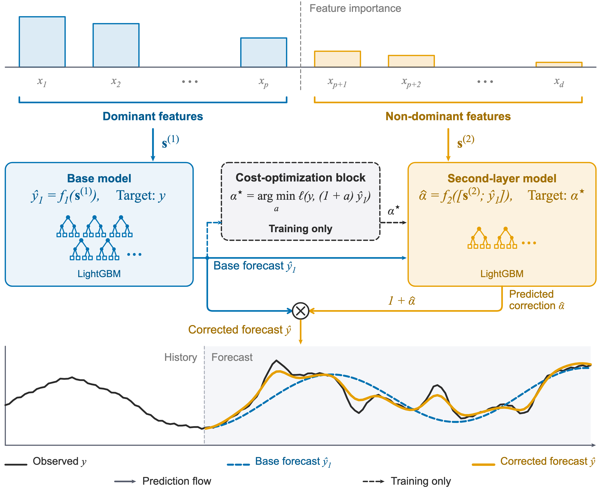

# Forecast-correction hero figure



A 120 × 100 mm schematic of HEFS (§3, Algorithm 2): features are sorted by importance and split at p into a dominant group 𝐬⁽¹⁾ = (x₁ … x_p) and a non-dominant group 𝐬⁽²⁾ = (x_{p+1} … x_d); a base model forecasts ŷ₁ = f₁(𝐬⁽¹⁾) (target y); a second-layer model predicts a relative correction α̂ = f₂([𝐬⁽²⁾; ŷ₁]) (target α⋆); the corrected forecast is ŷ = (1 + α̂)ŷ₁. Solid arrows are the prediction flow; dashed arrows and the cost-optimization block are training only: the block turns ŷ₁ and the observed y into the optimised correction target α⋆. The curves are an illustrative toy signal, not paper data. Caption: [docs/caption.md](docs/caption.md).

Two versions from one source:
- `forecast-hero` (light, the web hero): `figure/figure.js`.
- `forecast-hero-detailed` (adds the search bound a ∈ [−β, β] and the base-forecast error band): `figure/figure_detailed.js`.

- `figure/hero.js`: the drawing; `figure/parts.js`: the toy signal, plot frame and tree glyph.
- `figure/out/`: `<name>.pdf` (vector), `.svg`, `.png` (600 dpi), `-thumb.png`.
- `docs/`: brief, spec, caption, the source of every label (`facts.md`), critique and reader test.

Rebuild (from this folder, with the `schematic-figure` skill installed):

```
node ~/.claude/skills/schematic-figure/foundation/tools/render.mjs --root . --fig figure/figure.js
node ~/.claude/skills/schematic-figure/foundation/tools/render.mjs --root . --fig figure/figure_detailed.js
```

Earlier versions: `figure/_versions/` (5 = revision 1, 6 = revision 2). Earlier drafts and the website figure gallery are archived at the git tag `figure-designs-archive`.
