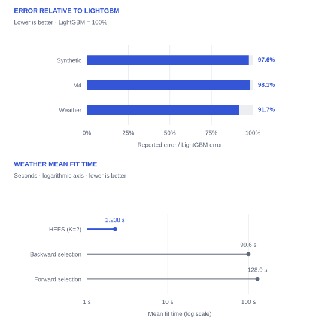

# Evidence and tradeoffs

Two-layer HEFS performs well across the three studied datasets. Its clearest practical tradeoff is competitive error with much shorter fit times than wrapper selection.

## Evaluation setting

The paper uses LightGBM as the base regressor throughout. Section 4 describes three-fold `TimeSeriesSplit`, randomized hyperparameter search, and evaluation over 30 random seeds. Feature-group boundaries are tuned along with model parameters. The datasets are deliberately sample-limited: 300 synthetic observations, 400 M4 observations, and 300 Weather observations (Table 2).

The values below are **transcribed from the published paper**, not rerun results. [reproduce.md](reproduce.md) introduces the model API, experiment setup, and dataset sources.

## Reported test error

| Model | Synthetic | M4 | Weather |
| --- | ---: | ---: | ---: |
| Filter | 1.023 | 0.105 | 0.0123 |
| Forward Wrapper | 1.004 | 0.106 | 0.0111 |
| Backward Wrapper | 0.980 | 0.107 | 0.0110 |
| Embedded | 0.978 | 0.109 | 0.0135 |
| Ensemble | 0.965 | 0.111 | 0.0134 |
| Baseline LightGBM | 0.980 | 0.105 | 0.0120 |
| **HEFS (K=2)** | **0.956** | **0.103** | **0.0110** |
| HEFS (K=3) | 0.977 | 0.111 | 0.0153 |
| HEFS (Ablation) | 0.962 | 0.106 | 0.0122 |

Source: paper, Table 3. Lower is better. Bold identifies the two-layer HEFS row; it does not denote statistical significance.

> **Metric naming in the paper**
>
> Table 3 is captioned “Test MSE” and Table 4 “Train MSE,” while the surrounding text and evaluation protocol describe MAE. The repository uses `neg_mean_absolute_error` for search and aggregates MAE in its experiment scripts. Without the original per-run results, these values cannot be independently relabeled. The project page calls them **reported test error** and preserves the published numbers. The standalone quickstart explicitly computes MAE.

*Top: two-layer HEFS’s reported error as a percentage of full-feature LightGBM’s error, with each baseline normalized to 100%. Bottom: Weather mean fit times on a logarithmic axis. The error comparison and timing comparison use different reference methods.*

HEFS (K=2) has the lowest displayed error on Synthetic and M4. On Weather, its `0.0110` matches backward selection at the reported precision. Relative to full-feature LightGBM, the reported errors are approximately 2.4%, 1.9%, and 8.3% lower on Synthetic, M4, and Weather respectively; these percentages are arithmetic comparisons of rounded Table 3 values.

## Training cost

| Model | Synthetic | M4 | Weather |
| --- | ---: | ---: | ---: |
| Filter | 0.316 | 1.763 | 6.048 |
| Forward Wrapper | 153.2 | 71.38 | 128.9 |
| Backward Wrapper | 265.9 | 135.5 | 99.60 |
| Embedded | 0.531 | 11.89 | 2.572 |
| Ensemble | 11.74 | 13.26 | 3.533 |
| Baseline LightGBM | 0.556 | 6.309 | 0.591 |
| **HEFS (K=2)** | **2.478** | **10.56** | **2.238** |
| HEFS (K=3) | 3.779 | 5.453 | 1.263 |
| HEFS (Ablation) | 4.231 | 11.16 | 1.407 |

Source: Table 6. Times are in seconds, measured on a 14-inch Apple M3 MacBook Pro with 16 GB unified memory. The paper defines these as `RandomizedSearchCV`’s `mean_fit_time`; they are not total hyperparameter-search times or inference latency.

On Weather, backward selection takes about **44.5×** as long as HEFS (99.60 / 2.238), with equal displayed test error. Forward selection takes about **57.6×** as long (128.9 / 2.238), with slightly higher displayed error. HEFS is not the fastest method overall: full-feature LightGBM fits in 0.591 s on Weather.

## What the ablations tell us

**Cost optimization:** removing the multiplicative correction mechanism and using the residual ablation raises reported test error on all three datasets. Table 5 reports a statistically significant advantage over the ablation on Weather (`p = 0.0009`), but not on Synthetic (`p = 0.1710`) or M4 (`p = 0.0644`) at a 0.05 threshold.

**Hierarchy depth:** three layers do not improve the displayed test errors over two layers. Although the three-layer model fits faster on M4 and Weather, the corresponding test errors are worse. Extra depth is a design choice to validate, not an automatic improvement.

**Statistical evidence:** Table 5 does not establish significance against every comparison. Against full-feature LightGBM, it reports `p = 0.0015` on Synthetic, `0.1570` on M4, and `0.0006` on Weather. Against backward selection on Weather, it reports `p = 0.4830`. Rounded values alone should not be read as proof of a reliable advantage.

## Scope and limitations

The evidence concerns three sample-limited experimental settings, rather than all forecasting tasks. Benefits may diminish with abundant training data or when features lack clear dominant groups. The study’s grouping strategies are manual or based on simple relevance criteria; automated grouping remains future work.

Next: [reproduce.md](reproduce.md).

